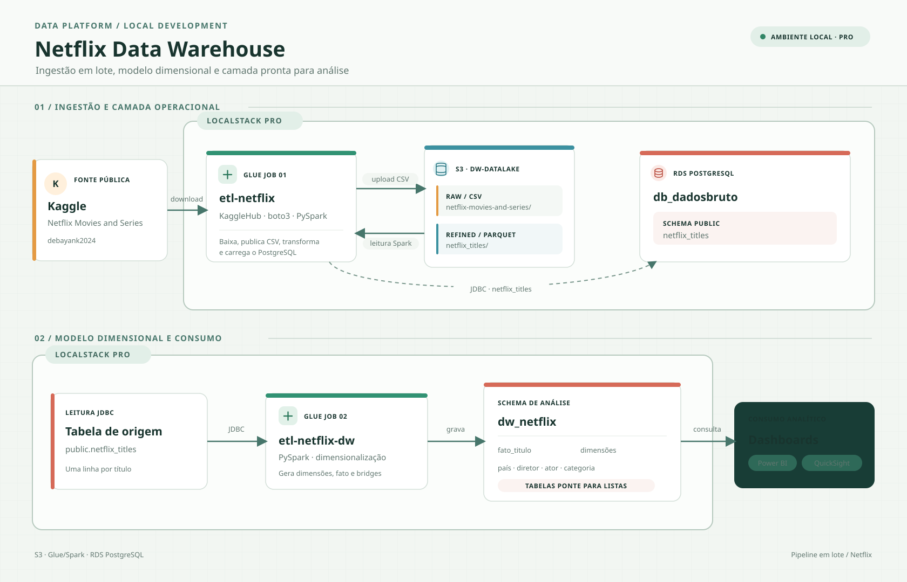
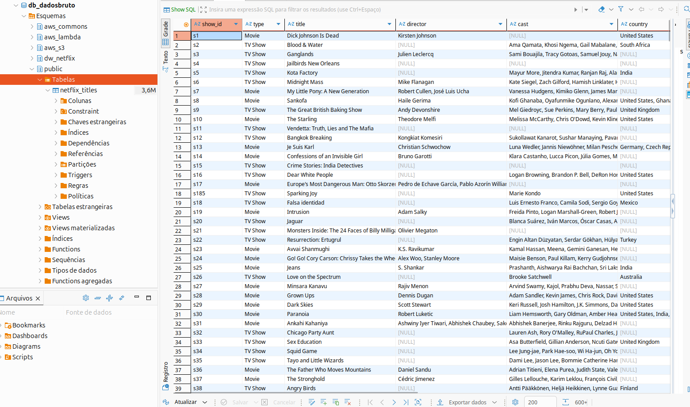
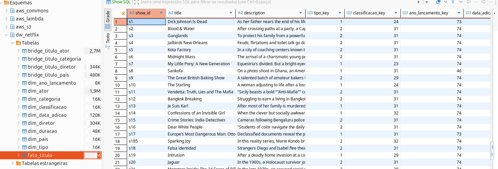
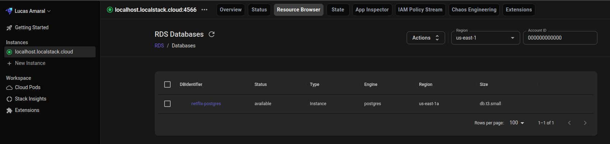
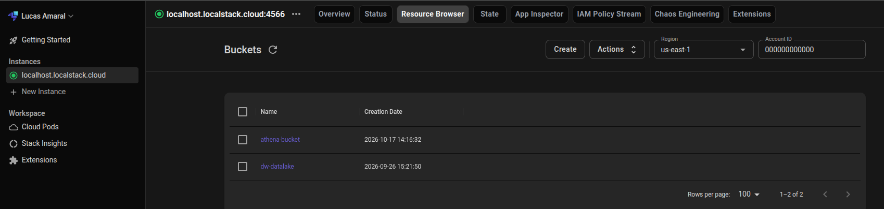

# Data Warehouse com LocalStack

Este diretório configura um ambiente local LocalStack Pro com S3, Glue, Athena e RDS PostgreSQL. O fluxo usa dois jobs Glue: um carrega o dataset Netflix do Kaggle e outro transforma a tabela operacional em um modelo dimensional.

## Visão do projeto



## Pré-requisitos

- Docker e Docker Compose.
- Um Auth Token LocalStack Pro ativo, fornecido pela variável `LOCALSTACK_AUTH_TOKEN`.
- Acesso HTTPS de saída para ativação da licença, download do driver JDBC e instalação do `kagglehub` pelo Glue.
- Portas `4566` e `4510-4559` disponíveis. Pare outra instância LocalStack que esteja usando essas portas antes de iniciar esta configuração.

Não grave o Auth Token no Compose nem no Git.

## Iniciar

Execute a partir deste diretório:

```bash
export LOCALSTACK_AUTH_TOKEN='<seu token>'
docker-compose up -d
docker-compose ps
```

Os scripts em `init/` são executados quando o LocalStack fica pronto. Eles criam a instância RDS emulada, preparam o bucket, publicam os jobs, baixam o driver JDBC e registram os jobs e o crawler. Para acompanhar a inicialização:

```bash
docker-compose logs -f localstack
```

Se editar um job ou o script de setup depois da inicialização, publique novamente e atualize o Glue executando:

```bash
docker exec localstack-dw bash /etc/localstack/init/ready.d/01-setup-datalake.sh
```

## Jobs Glue

Execute primeiro `etl-netflix`. Ele baixa o dataset público `debayank2024/netflix-movies-and-series` com KaggleHub, envia os CSVs ao S3, lê os dados com Spark, grava Parquet e carrega a tabela `public.netflix_titles` no PostgreSQL. O crawler `crawler-netflix` cataloga a saída refinada.

```bash
docker exec localstack-dw awslocal glue start-job-run --job-name etl-netflix
```

Depois que `etl-netflix` terminar com estado `SUCCEEDED`, execute o job dimensional:

```bash
docker exec localstack-dw awslocal glue start-job-run --job-name etl-netflix-dw
```

Consulte a execução mais recente de cada job:

```bash
docker exec localstack-dw awslocal glue get-job-runs --job-name etl-netflix --max-results 1
docker exec localstack-dw awslocal glue get-job-runs --job-name etl-netflix-dw --max-results 1
```

O script `scripts/run_pipeline.sh` executa `etl-netflix` e o crawler. Ele não inicia `etl-netflix-dw`; execute esse job separadamente após a carga inicial.

## Armazenamento e modelo

| Destino | Conteúdo |
|---|---|
| `s3://dw-datalake/raw/netflix-movies-and-series/` | CSVs baixados do Kaggle. |
| `s3://dw-datalake/refined/netflix_titles/` | Arquivos Parquet gerados pelo primeiro job. |
| `db_dadosbruto.public.netflix_titles` | Tabela de origem carregada pelo primeiro job. |
| `db_dadosbruto.dw_netflix` | Modelo dimensional gerado pelo segundo job. |

O schema `dw_netflix` contém `fato_titulo`; dimensões `dim_tipo`, `dim_classificacao`, `dim_ano_lancamento`, `dim_data_adicao`, `dim_duracao`, `dim_pais`, `dim_diretor`, `dim_ator` e `dim_categoria`; e associações `bridge_titulo_pais`, `bridge_titulo_diretor`, `bridge_titulo_ator` e `bridge_titulo_categoria`.

As tabelas são gravadas em modo `overwrite`: cada execução substitui os dados/tabelas de destino correspondentes.

## Exemplos das tabelas PostgreSQL

### Dados brutos

A tabela `public.netflix_titles` contém os registros operacionais carregados pelo job `etl-netflix`.



### Data warehouse dimensional

O schema `dw_netflix` organiza os títulos em uma fato, dimensões e tabelas de associação.



## Exemplos no console LocalStack

### RDS PostgreSQL

A captura mostra a instância `netflix-postgres` com status `available` e mecanismo PostgreSQL.



### S3

A captura mostra os buckets disponíveis no LocalStack, incluindo `dw-datalake`, usado pelo pipeline.



## PostgreSQL local

O PostgreSQL é emulado pelo serviço RDS do LocalStack. O banco padrão é `db_dadosbruto`, usuário `dwadmin` e senha local padrão `dwlocal123`; esses valores podem ser alterados por `RDS_DB_NAME`, `RDS_MASTER_USERNAME` e `RDS_MASTER_PASSWORD` antes de iniciar o Compose. O setup consulta a porta atribuída ao RDS; na configuração validada, ela foi `4510`.

Para consultar as tabelas dentro do container:

```bash
docker exec -it localstack-dw /usr/lib/postgresql/17/bin/psql \
  -h 127.0.0.1 -p 4510 -U dwadmin -d db_dadosbruto
```

No prompt do `psql`, por exemplo:

```sql
SELECT table_name
FROM information_schema.tables
WHERE table_schema = 'dw_netflix'
ORDER BY table_name;

SELECT COUNT(*) FROM dw_netflix.fato_titulo;
```

## Persistência

`volume/` contém estado persistido do LocalStack, incluindo dados do RDS, cache e logs. Ele é ignorado pelo `.gitignore` local; mantenha-o para preservar o ambiente. Os CSVs de dados locais e JARs baixados também são ignorados conforme as regras do `.gitignore`.

## Dashboards

É possível conectar ferramentas como Power BI, AWS QuickSight e outras soluções de BI às tabelas do PostgreSQL para gerar dashboards e análises dos dados.

